# Falkenrath demo tree

**English** · [Deutsch](README.md)

A **fictitious** family tree for trying out and testing genealogy software: 492 people, 154 families, 204 sources,
40 repositories and 142 images, from around 1750 to today. It was built for testing webtrees, the module
[api4webtrees](https://github.com/thobgg/api4webtrees) and the apps [wtAnd, wtWin, wtTux and wtMac](https://github.com/thobgg/app4webtrees),
but it is plain GEDCOM 5.5.1 and works with any program.

**All people, dates and documents are made up.** Any resemblance to living or dead persons is coincidental. The places
are real and carry coordinates, so that maps have something to show. Bienenbüttel has four farms and houses as GEDCOM-L location records
(`_LOC` with type, superior place and building events) with residents and owners – test data for farm lists and local heritage books.
The location records of the buildings carry GOV type numbers (`2 _GOVTYPE`: mill 87, farm 24, building 17) so that programs and online local heritage books recognise a farm by the number rather than a word.
Every item of the GEDCOM-L addendum occurs (unique identifiers, call names, highlighted images, research tasks, family status, GOV identifier, postal code and Maidenhead locator at places, municipality key and population at the location record) – programs can test their GEDCOM-L support completely.
The tree comes in GEDCOM 5.5.1 and also in **GEDCOM 7.0** (as GEDZIP and as a single file).

**Where the file comes from:** it is produced by Python scripts (in [werkzeuge/](werkzeuge/)), neither by webtrees nor
by hand. Hence the header `1 SOUR PYTHON-SKRIPTE-BUGGE` with `2 VERS 1.7`, plus `1 SUBM` and the GEDCOM-L addendum
(R2 of 2020-12-01) under `GEDC`.

The **wedding photo of 1924** (`media/hochzeit-1924.jpg`, family F8) is a group photo with 23 faces: 21 people from the tree,
the witness Wilhelm Niebuhr by name only and one unknown guest. The face frames are stored as XMP in the image file; `hochzeit-1924-unmarkiert.jpg`
is the same picture without frames for marking by hand – try it with wtWin/wtTux 1.48 or later and the Sammlungen module 1.10 or later.

**The portraits are real old studio photographs of unknown people** from the Rijksmuseum Amsterdam (CC0, via
Wikimedia Commons). The people shown have nothing to do with the invented names; sources are listed in
[FOTOS.md](FOTOS.md). Not everyone has a picture, as in real trees: most direct ancestors do, side lines less often,
nobody before 1860, and nobody born after 1920. Certificates, church book and register extracts are drawn.

**License:** [CC0 1.0](LICENSE). Free to use for anything, including screenshots, demos and test suites.

**Download:** [GEDCOM file only](https://github.com/thobgg/falkenrath-demo-tree/raw/main/versionen/falkenrath-1.7.ged) (470 KB) ·
[GEDCOM 5.5.1 with all images as zip](https://github.com/thobgg/falkenrath-demo-tree/releases/latest/download/falkenrath-1.7.zip) (7 MB, `falkenrath-1.7.ged` and images in one folder) ·
[GEDCOM 7.0 as GEDZIP](https://github.com/thobgg/falkenrath-demo-tree/releases/latest/download/falkenrath-1.7.gdz) (7 MB, `gedcom.ged` in GEDCOM 7.0 plus images) ·
[GEDCOM 7.0 single file](https://github.com/thobgg/falkenrath-demo-tree/releases/latest/download/falkenrath-1.7-gedcom7.ged) (540 KB) ·
[release](https://github.com/thobgg/falkenrath-demo-tree/releases/latest)

## The Falkenrath dynasty 😉

No nobility, no coat of arms, no castle – but a founding father: **Hans Jürgen Falkenrath** (1770–1831), a landless
cottager in Eschede whose wife the parish register did not even bother to name. The family likes to say the name comes
from a falconer at the court of Celle; the family chronicler found that story "nice, but unproven". Then come
carpenters in Celle, a builder in Milwaukee, a joiner's workshop – and today a civil engineer. The Falkenraths have been
building things for over 160 years; only the plans got bigger. The full (made-up) story, in German:
[FAMILIENGESCHICHTE.md](FAMILIENGESCHICHTE.md).

## Pictures

<p align="center">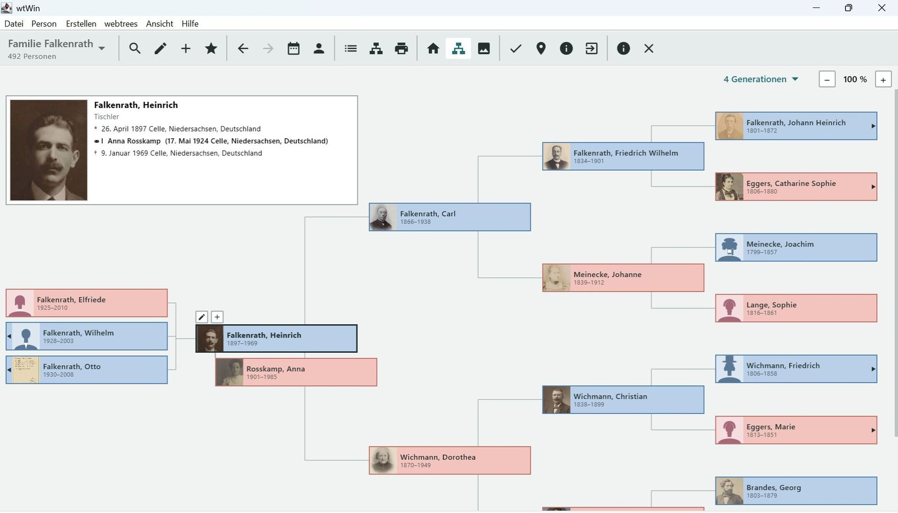</p>
<p align="center"><sub>The tree in <a href="https://github.com/thobgg/app4webtrees">wtWin</a>: Heinrich Falkenrath with his children and four generations of ancestors.</sub></p>

<p align="center">
  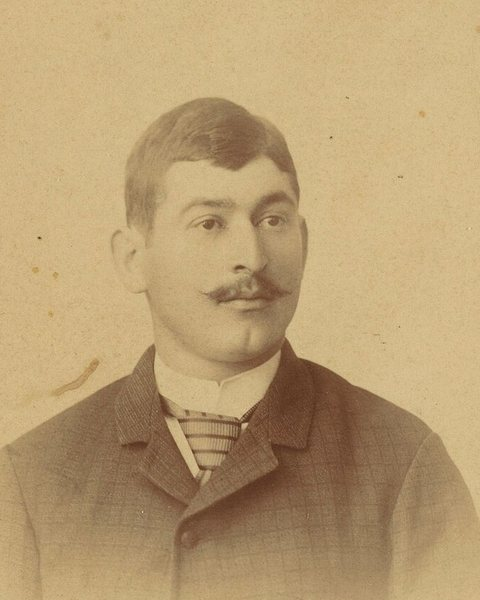
  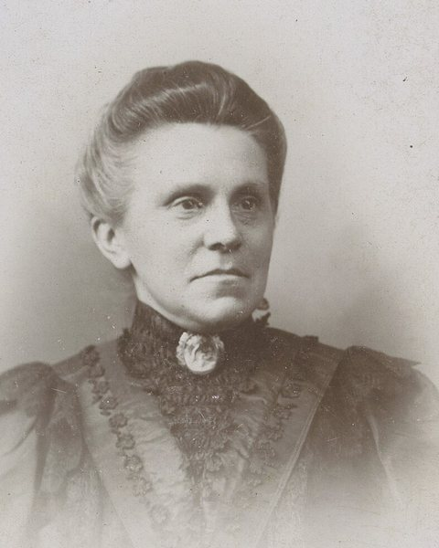
  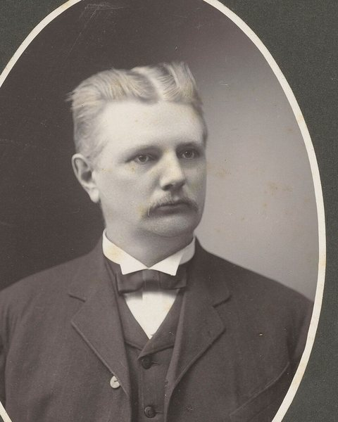
  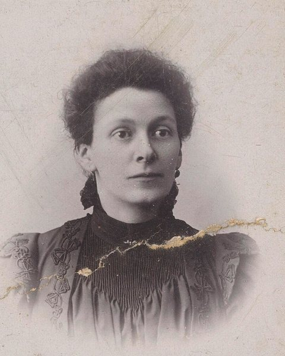
  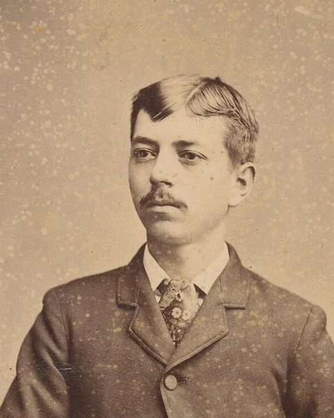
  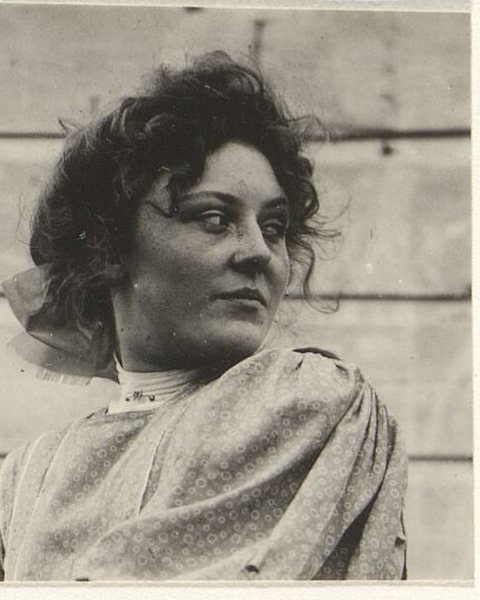
</p>
<p align="center"><sub>Portraits: real studio photographs of <b>unknown people</b> from the Rijksmuseum Amsterdam, public domain (CC0).
The people shown have nothing to do with the invented names in the tree. Sources for every file in <a href="FOTOS.md">FOTOS.md</a>.</sub></p>

<p align="center">
  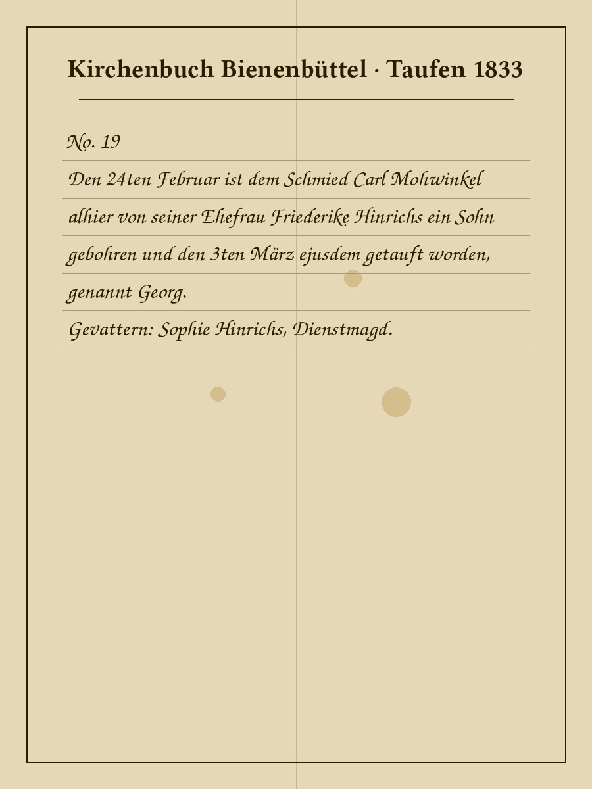
  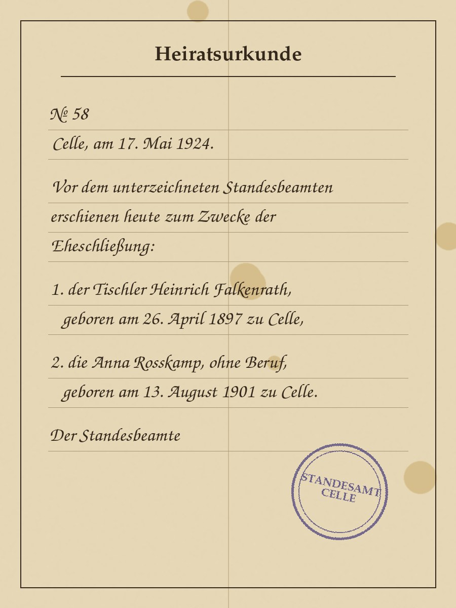
  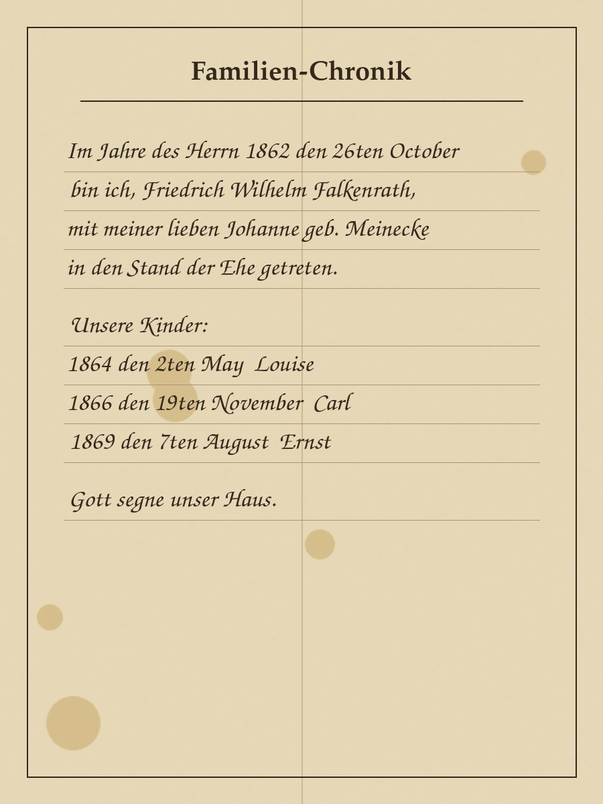
  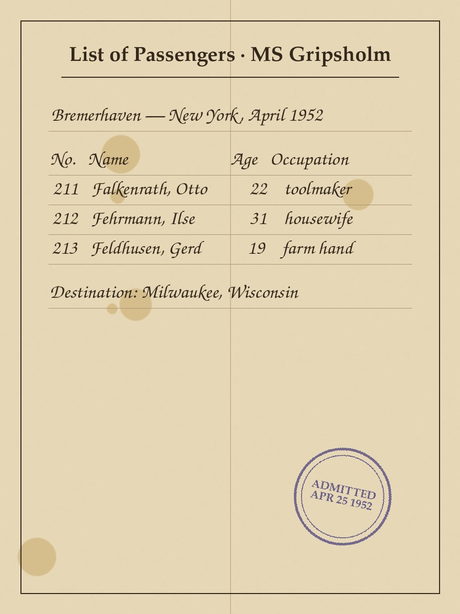
</p>
<p align="center"><sub>Church book entries, certificates, the family chronicle and the passenger list are <b>drawn for this tree</b>.
Their texts match the data in the GEDCOM file, so apps can show a transcript next to the scan.</sub></p>

<p align="center">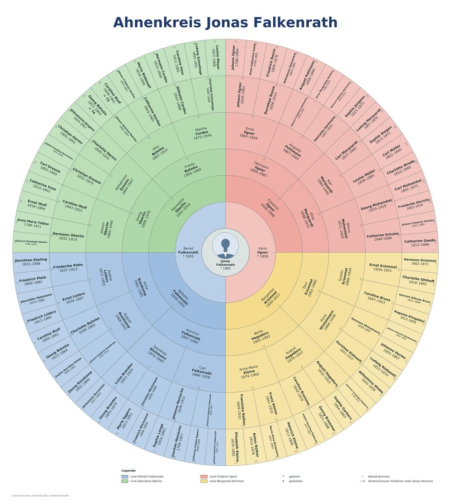</p>
<p align="center"><sub>Fan chart of Jonas Falkenrath: seven complete generations, 127 ancestors.</sub></p>

All pictures in this repository may be used freely under CC0, including the two screenshots. For the portraits,
please do not present the people shown as members of the Falkenrath family outside of a demo context: they are real,
unknown people.

## Download

- The current version is 1.7: [`versionen/falkenrath-1.7.ged`](versionen/falkenrath-1.7.ged) ([direct download](https://github.com/thobgg/falkenrath-demo-tree/raw/main/versionen/falkenrath-1.7.ged)) with the images in [`media/`](media/).
- The [release](https://github.com/thobgg/falkenrath-demo-tree/releases/latest) has a ready-made zip with the GEDCOM 5.5.1 file, all images
  in the same folder and this README, and a GEDZIP (`.gdz`) with the data converted to GEDCOM 7.0 (`werkzeuge/gedcom7.py`).

The tree is in German: names, places, occupations, notes and source titles. Dates and structure are standard GEDCOM.

## What the tree covers

- **Ancestors:** the proband Jonas Falkenrath (I1) has a complete pedigree over seven generations, 127 ancestors,
  with gaps beyond that. Pedigree collapse: the parents of no. 37 are also nos. 88 and 89.
- **Descendants:** a broad line from Johann Friedrich Falkenrath (born 1843) to today, with siblings of the ancestors
  and cousins on both sides.
- **Life events:** two marriages with an early-deceased child, a divorce, soldiers killed in both world wars, two
  emigrations to Milwaukee (1888 and 1952) with an American branch, an unknown mother at the top.
- **Church and civil records:** baptisms, burials, a Catholic line from the Paderborn area, religion, causes of death.
- **Living people** for privacy tests.
- **Godparents and marriage witnesses** in several encodings, see below.
- **Sources in three levels** covering every variant GEDCOM 5.5.1 knows, see below.

## Sources in three levels

| Level | Question | GEDCOM | webtrees |
| - | - | - | - |
| 1 | Where is the source kept? | `0 @R…@ REPO` | Repository |
| 2 | What is the source? | `0 @S…@ SOUR` with `1 REPO`, `2 CALN` (call number), `3 MEDI` | Source |
| 3 | Where exactly is it written? | on the fact: `2 SOUR @S…@` with `3 PAGE`, `3 QUAY` … | Citation |

Repositories, call numbers, addresses and volume ranges are invented; web addresses end in `.example.org`.

- **Church books (140):** one mixed register per parish up to a year between 1790 and 1815, then separate books for
  baptisms, marriages and burials in three volumes each.
- **Civil registers (61):** births, marriages and deaths per registry office. German closure periods split the
  registers: older volumes are in the archive, newer ones still at the registry office.
- **Family collection:** certificates in family hands for the younger direct line (S203).
- **Civil and church events:** the registry office records birth, marriage and death; the church records baptism,
  church wedding and burial. Before 1875 birth and death cite the baptism or burial entry with `3 EVEN CHR` or
  `3 EVEN BURI` and `QUAY 2`. The 15 couples of the direct line from 1890 have two marriages, `TYPE civil` and
  `TYPE religious`.
- **QUAY:** 3 for an entry about the event itself, 2 for derived information, 1 for doubtful, 0 for unreliable.
  About a third of the citations, mostly in side lines, have no `QUAY` on purpose.

### Test cases for sources

| Test case | Where |
| - | - |
| Repository with address, phone, e-mail, web | R5, R22 |
| Repository with name only | R6 |
| Repository with web address and note only | R4 |
| Repository without any source | R40 |
| Source with two repositories (original and digital copy) | volumes of the Uelzen church district, e.g. S5 |
| Source with short title (`ABBR`) | volumes of the Celle church district, e.g. S1 |
| Source with `DATA/AGNC` | volumes of the Lüneburg church district, e.g. S8 |
| Source with image (title page) | S1 |
| Source with text, publisher, image | S3 family bible |
| Source without repository | S4 German casualty lists |
| Call number without medium | civil registers in an archive, e.g. S2 |
| Repository link without call number | registers at the registry office, e.g. S40; S203 |
| Source never cited | S204 |
| Transcript (`DATA/TEXT`), also multi-line with `CONT`/`CONC` | 20 entries, e.g. I130 baptism, F8 marriage, I276 birth |
| Scan attached to the citation | I130, I111 (Latin), F76, I214, I276, I182, I52, F8 |
| Two sources on one fact | I15 birth, F8 civil marriage |
| Conflicting sources (two birth dates) | I39 |
| Source on the person with `EVEN`/`ROLE` (godparent) | I62, I271, I371 |
| Source directly on the family | F8 |
| Source on the name (call name) | I19 |
| Citation with note, `QUAY 1` | I52 burial, I39 second birth |
| Source as plain text without a record, `QUAY 0` | I65 emigration 1888 |
| Marriage without `TYPE` | American branch, e.g. F10 |
| Church wedding cited from a marriage certificate | F3, F6, F7 |

## Godparents and marriage witnesses

Every baptism of the direct line has godparents, every civil marriage of the direct line has two witnesses, and
about half of the church weddings before 1875. Side lines are partly recorded. The reference is webtrees 2.2, which
writes the same form as the GEDCOM-L tags:

```
1 CHR
2 DATE 1 MAY 1897
2 PLAC Celle, Niedersachsen, Deutschland
2 _ASSO @I62@                 godparent with own record (linked)
3 RELA godparent
2 _GODP Friedrich Plate, Anbauer zu Celle     godparent without a record, one line per person
2 SOUR @S81@
3 PAGE Taufe 1897/77
```

- **Linked** (`_ASSO` with `RELA godparent` or `witness`): relatives from the tree. They are alive at the event,
  godparents at least 14, witnesses at least 21 (from 1975: 18), before 1920 men only.
- **Without a record**: `2 _GODP` at the baptism or `2 _WITN` at the marriage, one line per person,
  text `name, occupation at place`.
- Until 1.2 free godparents were a note `Paten: A; B`. Three test cases keep this older form.

### Test cases for godparents and witnesses

| Test case | Where |
| - | - |
| Baptism with linked godparents only | I22, I39 |
| Baptism with `_GODP` only | I52 (matches scan M130), I144 |
| Baptism mixed (`_ASSO` and `_GODP`) | I21, I28 |
| Godparents in the old note form `NOTE Paten: A; B` | I140, I141 |
| Living godmother (privacy) | I1, godmother I10 |
| Note on the godparent (`3 NOTE` under `_ASSO`) | I1 |
| Citation on the godparent (`3 SOUR` under `_ASSO`) | I21, godparent I65 |
| Person is godparent at several baptisms | I377 |
| `RELA godfather` / `godmother` (older webtrees data) | I38, I41 |
| `RELA Godparent`, capitalised (import from another program) | I57 |
| `1 ASSO` on the person instead of in the baptism (older form from other programs) | I58 |
| Witnesses mixed (`_ASSO` and `_WITN`) | F3, F6 |
| Witnesses with `_WITN` only | F38 |
| Witnesses in the old note form `NOTE Trauzeugen: …` | F60 |
| Witnesses also in the transcript of the civil record | F8, F15 |

## GEDCOM 7.0

The release has a GEDCOM 7.0 version, derived with [`werkzeuge/gedcom7.py`](werkzeuge/gedcom7.py):
`_UID`/`_ASSO` become `UID`/`ASSO`, `RELA` becomes `ROLE` (`GODP`, `WITN`, otherwise `PHRASE`), godparents and witnesses
without a record (`_GODP`, `_WITN`) become `ASSO @VOID@` with `PHRASE`, `_GOV` under `PLAC` becomes `EXID` with
`TYPE https://gov.genealogy.net/`, media get `FORM image/jpeg` and `MEDI`, a text-only source becomes its own `SOUR`
record, and `CONC`, `CHAR`, `GEDC.FORM` are dropped. The other GEDCOM-L tags (`_LOC`, `_GOVTYPE`, `_POST`, `_RUFNAME`,
`_TODO` …) stay as extensions without `HEAD.SCHMA`, since GEDCOM-L has not published URIs for them yet. The main file
stays GEDCOM 5.5.1, which is what webtrees 2.2 reads.

## Loading into webtrees

1. *Control panel → Manage family trees → Create a family tree*, e.g. `falkenrath`.
2. Import `falkenrath-1.7.ged`.
3. Give the tree its own media folder (*Preferences → Media folder*, e.g. `media/falkenrath/`) and upload the files
   from `media/` there (*Control panel → Media → Upload media files*), or copy them into `data/media/falkenrath/`.

## Version

Current version: 1.7 of 2026-10-15. Earlier intermediate versions are no longer published.

Issues and suggestions for further test cases are welcome.
