# Demo-Stammbaum „Familie Falkenrath“

**Deutsch** · [English](README.en.md)

Ein kleiner, **frei erfundener** Stammbaum zum Ausprobieren und Testen von webtrees, dem Modul
*api4webtrees* und der Apps *wtAnd*, *wtWin* und *wtTux*: 493 Personen, 155 Familien, 204 Quellen,
40 Archive, 142 Bilder, von um 1750 bis heute.

**Alle Personen, Lebensdaten und Dokumente sind ausgedacht.** Übereinstimmungen mit lebenden oder
verstorbenen Personen sind Zufall. Die Orte gibt es wirklich – sie tragen Koordinaten, damit Karten etwas
zu zeigen haben. Bienenbüttel hat vier Höfe und Häuser als GEDCOM-L-Ortsdatensätze (`_LOC` mit Art,
übergeordnetem Ort und Gebäudeereignissen) samt Bewohnern und Besitzern – Testdaten für Höfelisten und Ortsfamilienbücher.
Die Ortsdatensätze der Gebäude tragen GOV-Typnummern (`2 _GOVTYPE`: Mühle 87, Hof 24, Gebäude 17), damit Programme und Online-Ortsfamilienbücher Höfe an der Nummer statt an einem Wort erkennen.
Alle Angaben des GEDCOM-L-Addendums kommen vor (eindeutige Kennungen, Rufnamen, hervorgehobene Bilder, Forschungsaufgaben, Familienstand, GOV-Kennung, Postleitzahl und Maidenhead-Locator am Ort, Gemeindeschlüssel und Einwohnerzahl am Ortsdatensatz) – Programme können ihre GEDCOM-L-Unterstützung damit vollständig prüfen.
Den Baum gibt es in GEDCOM 5.5.1 und zusätzlich in **GEDCOM 7.0** (als GEDZIP und als einzelne Datei).

**Woher die Datei kommt:** Erzeugt haben sie Python-Skripte (in [werkzeuge/](werkzeuge/)), weder webtrees noch ein
Texteditor. Darum steht im Kopf `1 SOUR Python-Skripte` mit `2 VERS 1.10`, dazu `1 SUBM` und unter `GEDC` die
Angabe des GEDCOM-L-Addendums (R2 vom 1.12.2020).

Das **Hochzeitsbild 1924** (`media/hochzeit-1924.jpg`, Familie F8) ist ein Gruppenbild mit 23 Gesichtern: 21 Personen aus dem Baum,
der Trauzeuge Wilhelm Niebuhr nur als Name und ein Unbekannter. Die Gesichtsrahmen stehen als XMP in der Bilddatei; `hochzeit-1924-unmarkiert.jpg`
ist dasselbe Bild ohne Rahmen zum Markieren von Hand – zum Ausprobieren mit wtWin/wtTux ab 1.48 und dem Modul Sammlungen ab 1.10.

**Die Porträts sind echte alte Atelierfotos unbekannter Personen** aus dem Rijksmuseum Amsterdam (CC0, über
Wikimedia Commons). Die Abgebildeten haben mit den erfundenen Namen nichts zu tun; Liste der Quellen in
[FOTOS.md](FOTOS.md). Bewusst nicht jeder hat ein Bild – wie in echten Stammbäumen: die direkten Vorfahren
meist, Seitenlinien seltener, vor 1860 niemand, und ab 1920 Geborene keine (freie Fotos aus dieser Zeit gibt es
kaum, und die Jüngeren sind privat). Urkunden, Kirchenbuch- und Registerauszüge und die Werkstatt sind gezeichnet; das Hochzeitsbild ist eine Montage aus den Porträts.

Lizenz: [CC0 1.0](https://creativecommons.org/publicdomain/zero/1.0/deed.de) – frei verwendbar, auch für
Screenshots und Vorführungen.

**Version:** 1.10 vom 28.11.2026, [`versionen/falkenrath-1.10.ged`](versionen/falkenrath-1.10.ged) – neu sind DNA-Einträge in der Schreibweise des webtrees-Moduls dna4webtrees (Tests, Haplogruppen, Treffer mit `RESN`) und drei absichtlich falsche Einträge, siehe [DNA](#dna). Aus 1.9 stammen die ausgedachten DNA-Daten für Jonas Falkenrath (I1) in der Schreibweise von Gramps: fünf Treffer mit Verwandten und die Y-DNA zweier Männer derselben Linie. Aus 1.8 stammt Wei Li (I493), 2019 aus China eingewandert, verheiratet mit Julia Schnehage (F155). Sein Geburtsdatum stammt aus dem chinesischen Mondkalender: in 5.5.1 `DATE INT 12 SEP 2000 (庚辰年八月十五)`, in 7.0 `DATE 12 SEP 2000` mit `PHRASE 庚辰年八月十五`. Frühere Zwischenstände sind nicht mehr veröffentlicht.

**Herunterladen:** [nur die GEDCOM-Datei](https://github.com/thobgg/falkenrath-demo-tree/raw/main/versionen/falkenrath-1.10.ged) (470 KB) ·
[GEDCOM 5.5.1 mit allen Bildern als Zip](https://github.com/thobgg/falkenrath-demo-tree/releases/latest/download/falkenrath-1.10.zip) (7 MB, `falkenrath-1.10.ged` und Bilder im selben Ordner) ·
[GEDCOM 7.0 als GEDZIP](https://github.com/thobgg/falkenrath-demo-tree/releases/latest/download/falkenrath-1.10.gdz) (7 MB, `gedcom.ged` in GEDCOM 7.0 plus Bilder) ·
[GEDCOM 7.0 einzeln](https://github.com/thobgg/falkenrath-demo-tree/releases/latest/download/falkenrath-1.10-gedcom7.ged) (540 KB) ·
[Release](https://github.com/thobgg/falkenrath-demo-tree/releases/latest)

## Die Dynastie Falkenrath 😉

Kein Adel, kein Wappen, kein Schloss – aber ein Stammvater: **Hans Jürgen Falkenrath** (1770–1831), Häusling in Eschede,
dessen Frau das Kirchenbuch nicht einmal für erwähnenswert hielt. Der Name klingt nach Falknerei am Celler Hof, und genau
so erzählt es die Familie. Die Endung *-rath* stammt allerdings aus dem Bergischen Land, und die Familienchronistin
Pauline Rosskamp fand die Falknergeschichte „schön, aber nicht bewiesen“.

Danach geht es zügig bergauf, jedenfalls handwerklich: Friedrich Wilhelm zieht 1858 als Zimmergeselle nach Celle und
fängt die Familienbibel an. Sein Sohn Ernst hält es nicht aus und baut ab 1888 lieber Häuser in Milwaukee. Heinrich
heiratet 1924 die Wirtstochter vom „Allerkrug“ und lässt die halbe Verwandtschaft fürs Hochzeitsbild antreten
(plus einen Lokomotivführer, den sonst keiner kennt). Sein Sohn Wilhelm baut jede Schublade im Haus selbst. Und
Urenkel Jonas ist heute Bauingenieur – gebaut wird in dieser Dynastie seit über 160 Jahren, nur die Pläne sind größer
geworden.

Die ganze erfundene Geschichte steht in [FAMILIENGESCHICHTE.md](FAMILIENGESCHICHTE.md).

## Bilder

<p align="center">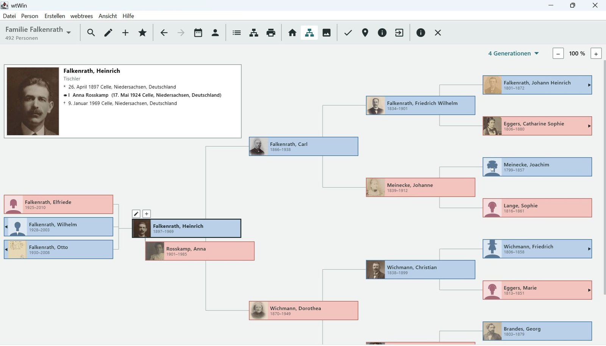</p>
<p align="center"><sub>Der Baum in <a href="https://github.com/thobgg/app4webtrees">wtWin</a>: Heinrich Falkenrath mit seinen Kindern und vier Generationen Vorfahren.</sub></p>

<p align="center">
  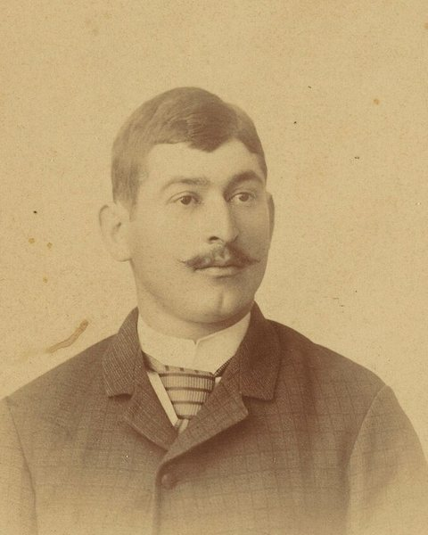
  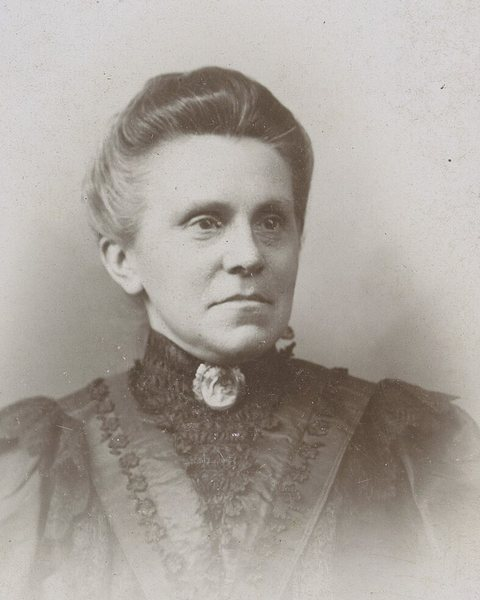
  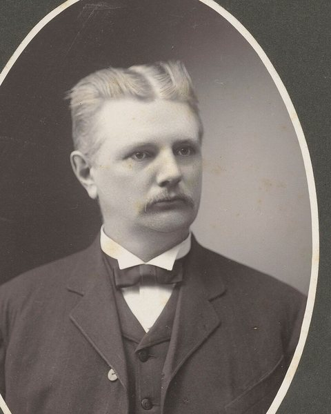
  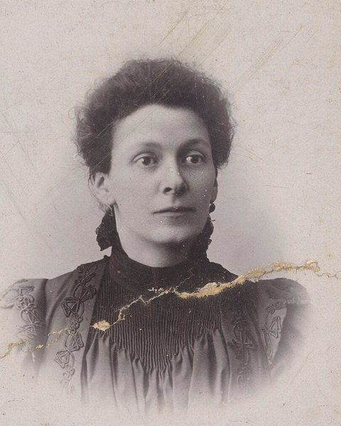
  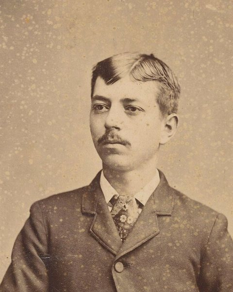
  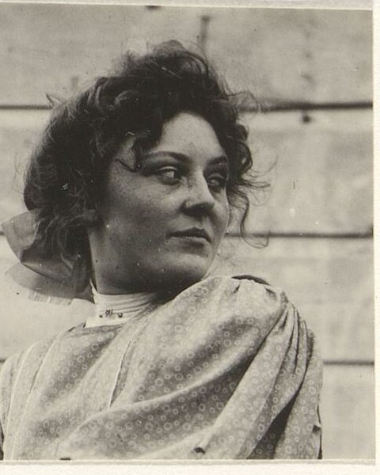
</p>
<p align="center"><sub>Porträts: echte Atelierfotos <b>unbekannter Personen</b> aus dem Rijksmuseum Amsterdam, gemeinfrei (CC0).
Die Abgebildeten haben mit den erfundenen Namen des Baums nichts zu tun. Quelle jeder Datei in <a href="FOTOS.md">FOTOS.md</a>.</sub></p>

<p align="center">
  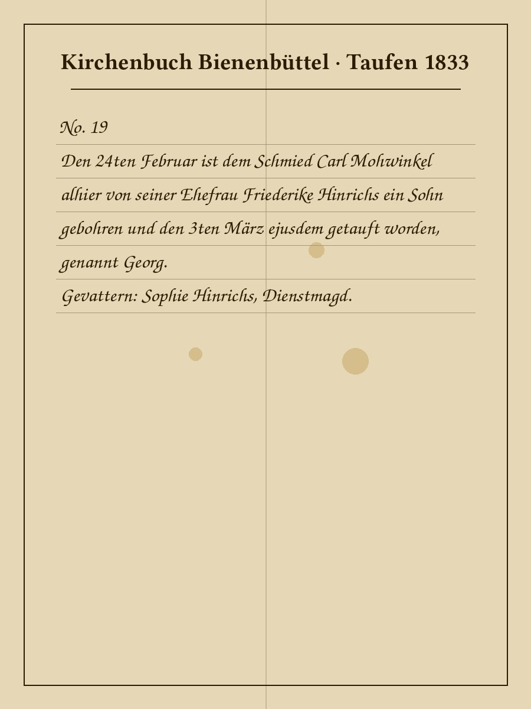
  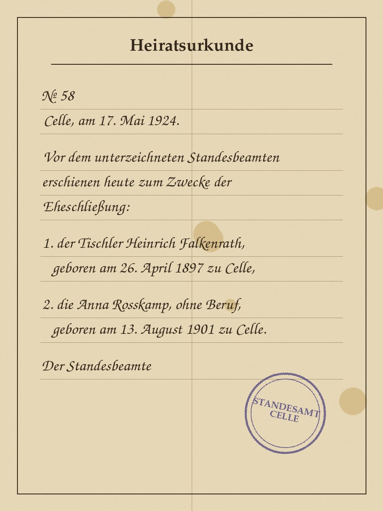
  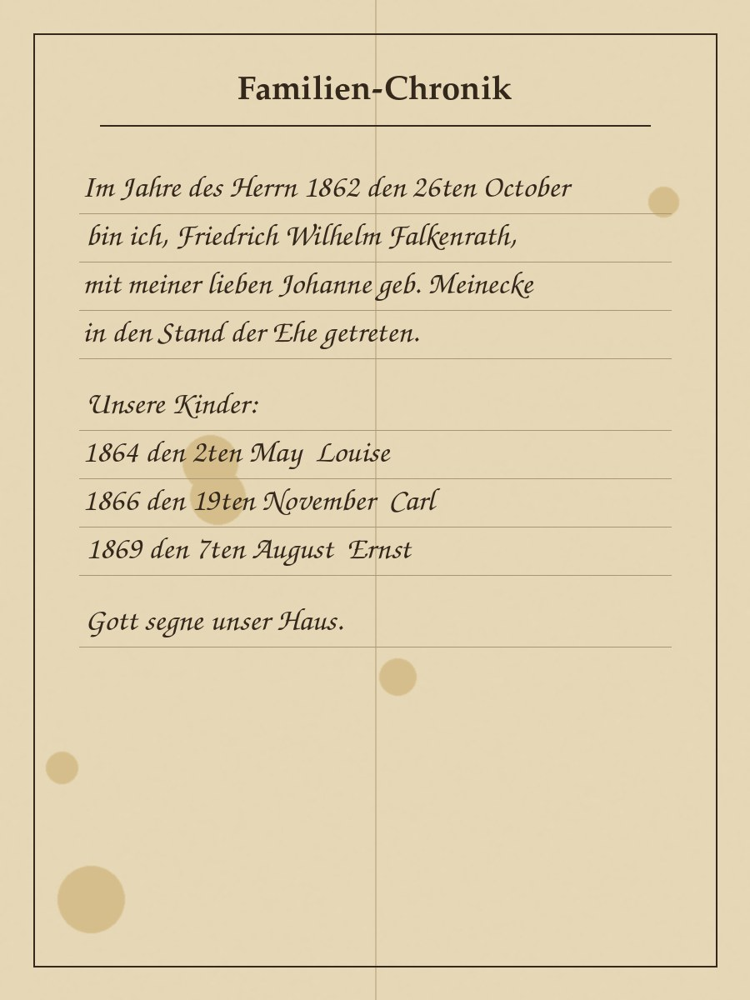
  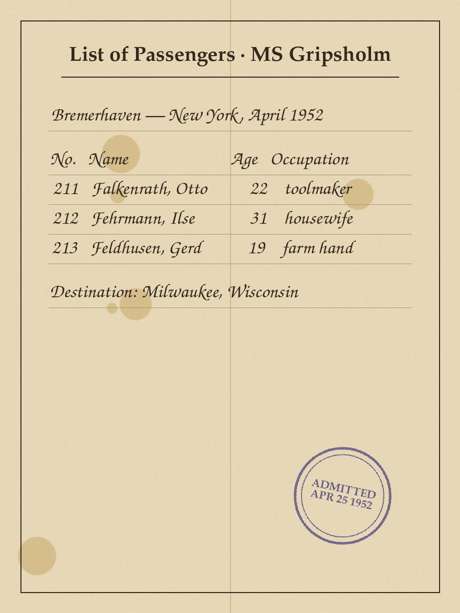
</p>
<p align="center"><sub>Kirchenbucheinträge, Urkunden, Familienchronik und Schiffsliste sind <b>für diesen Baum gezeichnet</b>.
Ihr Text passt zu den Daten im GEDCOM, damit Apps neben dem Scan die Abschrift zeigen können.</sub></p>

<p align="center">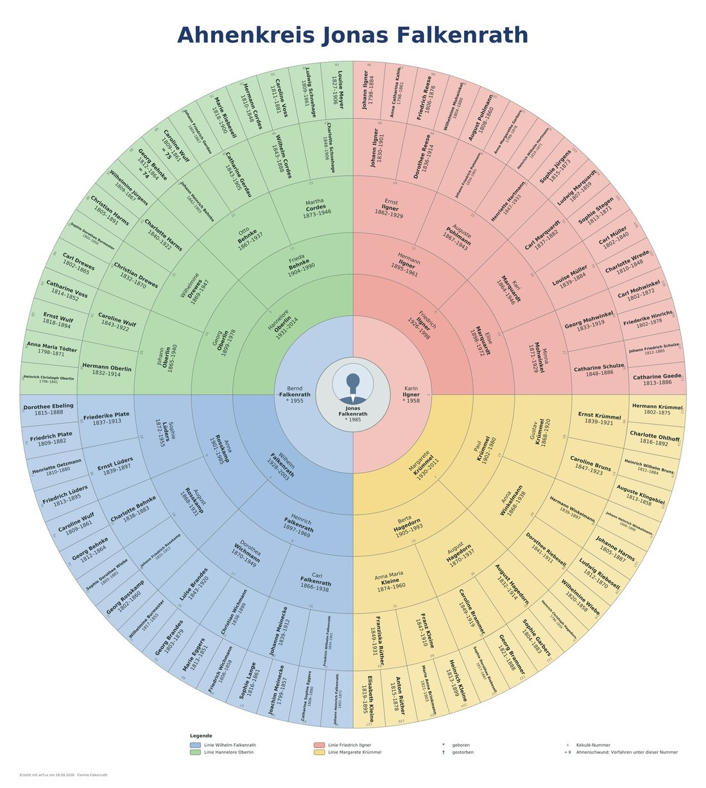</p>
<p align="center"><sub>Ahnenkreis von Jonas Falkenrath: sieben Generationen lückenlos, 127 Ahnen.</sub></p>

Alle Bilder in diesem Repository sind unter CC0 frei verwendbar, auch die beiden Bildschirmfotos. Bei den Porträts
bitte die Abgebildeten außerhalb einer Vorführung nicht als Mitglieder der Familie Falkenrath ausgeben: Es sind
echte, unbekannte Menschen.

## Was der Baum abdeckt

Lebende Personen (Datenschutz), zwei Ehen mit früh verstorbenem Kind, Gefallene beider Weltkriege,
zwei Auswanderungen nach Milwaukee (1888 und 1952) samt amerikanischem Zweig, eine Scheidung, eine unbekannte
Mutter an der Spitze, Vettern und Cousinen auf Vater- und Mutterseite, Quellen mit Seitenangaben, Notizen,
Rufname, Orte mit Koordinaten, Medien an Personen, Familien und Quellen.

Seit September 2026 außerdem: die Vorfahren von Jonas **lückenlos über sieben Generationen** (127 Ahnen),
dahinter mit Lücken; **Ahnenschwund** (die Eltern von Nr. 37 sind auch Nr. 88/89); Geschwister der Vorfahren;
ein breiter **Stamm** ab Johann Friedrich Falkenrath (* 1843) bis heute; Taufen mit **Paten**, Trauungen mit
**Zeugen**, Begräbnisse, **Konfession** (eine katholische Linie aus dem Paderborner Land), **Todesursachen**;
Kirchenbücher und Standesämter als Quellen mit Seitenangaben – Stoff für Tafeln, Listen und Bücher.
Proband: **Jonas Falkenrath (I1)**.

## Quellen – dreistufig

Die Quellen sind so angelegt, wie man es vorbildlich macht, und decken dabei jede
Variante ab, die GEDCOM 5.5.1 bei Quellen kennt – gedacht zum Testen von Apps wie *wtWin* und *wtTux*.
**Archive, Signaturen, Adressen und Bandlaufzeiten sind erfunden**; Web-Adressen enden auf `.example.org`.

| Ebene | Frage | GEDCOM | webtrees |
| - | - | - | - |
| 1 | Wo liegt die Quelle? | `0 @R…@ REPO` | Archiv |
| 2 | Was ist die Quelle? | `0 @S…@ SOUR` mit `1 REPO` → `2 CALN` (Signatur) → `3 MEDI` | Quelle |
| 3 | Wo genau steht es? | am Fakt `2 SOUR @S…@` mit `3 PAGE`, `3 QUAY` … | Quellenangabe |

**Kirchenbücher** (140): je Ort ein Mischbuch bis zu einem Wechseljahr zwischen 1790 und 1815, danach getrennte
Bücher für Taufen, Trauungen und Begräbnisse in je drei Bänden. Angelegt sind nur Bände, aus denen zitiert wird –
die Signaturen (`KB Eschede Nr. 1` …) haben deshalb Lücken. Titel: `KB Eschede ev. Taufen 1812-1845`,
`KB Paderborn kath. Taufen 1854-1905` (lateinischer Originaltitel als Notiz).

**Standesämter** (61): je Amt Geburten, Heiraten, Tode. Die **Sperrfristen** (Geburt 110, Heirat 80, Tod 30 Jahre)
teilen die Register: Ältere liegen im Stadt- bzw. Kreisarchiv (`StA Celle Geburten 1874-1916`), jüngere noch beim
Standesamt (`StA Celle Geburten 1917-`). Für die jüngere direkte Linie gibt es stattdessen die
**Urkundensammlung Familie Falkenrath** (S203) im Familienbesitz.

**Das Standesamt beurkundet, die Kirche vollzieht:**

| Quelle | Ereignis | Fakt | `PAGE` |
| - | - | - | - |
| Standesamt | Geburt / Heirat / Tod | `BIRT` / `MARR` + `TYPE civil` / `DEAT` | `Geburt 1913/24` · `Heirat 1924/58` · `Tod 1941/24` |
| Kirchenbuch | Taufe / Trauung / Begräbnis | `CHR` / `MARR` + `TYPE religious` / `BURI` | `Taufe 1811/6` · `Trauung 1797/3` · `Begräbnis 1837/5` |

Vor 1875 gab es kein Standesamt: Geburt und Tod zitieren dann denselben Eintrag wie Taufe bzw. Begräbnis,
mit `3 EVEN CHR` / `3 EVEN BURI` und `QUAY 2`. Die 15 Paare der direkten Linie ab 1890 haben **zwei Heiraten**:
standesamtlich und kirchlich.

**QUAY**: 3 = Eintrag zum Ereignis selbst, 2 = abgeleitet (Geburt aus Taufeintrag), Familienbibel, Verlustliste,
1 = fraglich, 0 = unzuverlässig. Rund ein Drittel der Angaben (Seitenlinien) ist bewusst ohne `QUAY`.

### Testfälle – wo zu finden

| Testfall | Fundstelle |
| - | - |
| Archiv mit Adresse, Telefon, E-Mail, Web | R5 Kirchenbuchamt Celle, R22 Stadtarchiv Celle |
| Archiv nur mit Name | R6 Pfarrarchiv Bergen |
| Archiv nur mit Web-Adresse und Notiz | R4 KirchenbuchDigital |
| Archiv ohne Quelle | R40 Heimatverein Eschede |
| Quelle mit zwei Archiven (Original + Digitalisat) | alle Bände des Kirchenkreises Uelzen, z. B. S5 |
| Quelle mit Kurztitel (`ABBR`) | Bände des Kirchenkreises Celle, z. B. S1 |
| Quelle mit `DATA/AGNC` | Bände des Kirchenkreises Lüneburg, z. B. S8 |
| Quelle mit Bild (Titelblatt) | S1 KB Eschede ev. Mischbuch |
| Quelle mit Text, Verlag, Bild | S3 Familienbibel |
| Quelle ohne Archiv | S4 Deutsche Verlustlisten |
| Signatur ohne Medium | Standesamtsregister im Archiv, z. B. S2 |
| Archivverweis ohne Signatur | Register beim Standesamt, z. B. S40; S203 Urkundensammlung |
| Quelle ohne Zitat | S204 KB Eschede ev. Konfirmationen |
| Abschrift (`DATA/TEXT`), auch mehrzeilig mit `CONT`/`CONC` | 20 Einträge, z. B. I130 Taufe, F8 Heirat, I276 Geburt |
| Scan an der Quellenangabe | I130 Taufe, I111 Taufe (lat.), F76 Trauung, I214 Begräbnis, I276 Geburt, I182 Tod, I52 Taufe 1801, F8 Heirat |
| Zwei Quellen an einem Fakt | I15 Geburt, F8 standesamtliche Heirat |
| Widersprüchliche Quellen (zwei Geburtsdaten) | I39 Carl Falkenrath |
| Quelle an der Person mit `EVEN`/`ROLE` (Pate) | I62, I271, I371 |
| Quelle direkt an der Familie | F8 (Familienstammbuch) |
| Quelle am Namen (Rufname) | I19 Friedrich „Fritz“ Ilgner |
| Quellenangabe mit Notiz, `QUAY 1` | I52 Begräbnis (schwer lesbar), I39 zweite Geburt |
| Quelle als reiner Text ohne Datensatz, `QUAY 0` | I65 Auswanderung 1888 |
| Heirat ohne `TYPE` | amerikanischer Zweig, z. B. F10 |
| Kirchliche Trauung mit Trauschein statt Kirchenbuch | F3, F6, F7 |

## Paten und Trauzeugen

Seit Oktober 2026 hat **jede Taufe der direkten Linie Paten** und jede standesamtliche Heirat der direkten Linie
**zwei Trauzeugen**; kirchliche Trauungen vor 1875 etwa zur Hälfte. Die Seitenlinien sind teilweise erfasst – wie in
echten Stammbäumen. Maßstab ist **webtrees 2.2**, das dieselbe Form schreibt wie die Vereinbarung deutschsprachiger
Genealogieprogramme und die GEDCOM-L-Tags:

```
1 CHR
2 DATE 1 MAY 1897
2 PLAC Celle, Niedersachsen, Deutschland
2 _ASSO @I62@                ← Pate mit eigenem Datensatz (verlinkt)
3 RELA godparent             ← webtrees: klein geschrieben, zeigt „Pate“/„Patin“
2 _GODP Friedrich Plate, Anbauer zu Celle    ← Pate ohne Datensatz (eine Zeile je Person)
2 SOUR @S81@
3 PAGE Taufe 1897/77
```

- **Verlinkt** (`_ASSO` + `RELA godparent` bzw. `witness`): Verwandte aus dem Baum – Großeltern, Geschwister der
  Eltern und deren Ehepartner, ältere Geschwister. Bei der Taufe leben sie und sind mindestens 14 (konfirmiert),
  Trauzeugen mindestens 21 (ab 1975: 18), vor 1920 nur Männer. webtrees zeigt beim Paten automatisch „Pate bei …“.
- **Ohne eigenen Datensatz**: `2 _GODP` an der Taufe bzw. `2 _WITN` an der Heirat, **eine Zeile je
  Person**, Text `Name, Beruf zu Ort` – so schreiben es verbreitete Programme, webtrees kennt beide als GEDCOM-L-Tags. Eine Taufe kann
  verlinkte und freie Paten haben. (Bis 1.2 standen freie Paten in einer Notiz `Paten: A; B` – drei Testfälle zeigen
  diese ältere Form noch.)
- Vor 1850 meist drei Paten, danach zwei.

### Testfälle Paten und Trauzeugen

| Testfall | Fundstelle |
| - | - |
| Taufe nur mit verlinkten Paten | I22, I39 |
| Taufe nur mit Paten ohne Datensatz (`_GODP`) | I52 (passt zum Scan M130), I144 |
| Taufe gemischt (`_ASSO` + `_GODP`) | I21, I28 |
| Paten in alter Notiz-Form `NOTE Paten: A; B` | I140, I141 |
| Lebende Patin (Datenschutz) | I1 Jonas Falkenrath, Patin I10 |
| Notiz am Paten (`3 NOTE` unter `_ASSO`) | I1 („Schwester des Vaters“) |
| Quellenangabe am Paten (`3 SOUR` unter `_ASSO`) | I21, Pate I65 (in Abwesenheit, mit Notiz) |
| Person ist bei mehreren Taufen Pate (Gegenrichtung) | I377 |
| `RELA godfather` / `godmother` (ältere webtrees-Daten) | I38, I41 |
| `RELA Godparent`, groß geschrieben (Import aus einem anderen Programm) | I57 |
| `1 ASSO` an der Person statt in der Taufe (ältere Form aus anderen Programmen) | I58 |
| Trauzeugen gemischt (`_ASSO` + `_WITN`) | F3, F6 |
| Trauzeugen nur ohne Datensatz (`_WITN`) | F38 |
| Trauzeugen in alter Notiz-Form `NOTE Trauzeugen: …` | F60 |
| Zeugen auch in der Abschrift des Standesamtseintrags | F8, F15 |

Erzeugt mit `werkzeuge/paten.py` (1.1 → 1.2, fester Zufallswert) und `werkzeuge/godp.py` (1.2 → 1.3).

## DNA

**Alle DNA-Daten sind ausgedacht**, wie der ganze Baum. Sie stammen von keinem Menschen und keinem Testanbieter; ein
Skript ([`werkzeuge/dna.py`](werkzeuge/dna.py)) hat die Segmente aus einem festen Startwert erzeugt. Die Summen passen
zur Verwandtschaft im Baum (Richtwerte des [Shared cM Project](https://thegeneticgenealogist.com/2020/03/27/version-4-0-march-2020-update-to-the-shared-cm-project/)).

GEDCOM kennt keine eigene Form für DNA-Treffer. Die Datei folgt der Schreibweise von **Gramps** und **Gramps Web**:
ein Treffer ist eine Beziehung mit der Art `DNA`, die gemeinsamen Segmente stehen als Tabelle in der Notiz dazu.
Andere Programme (auch webtrees) zeigen das als gewöhnliche Beziehung mit einer Notiz voller Zahlen.

```
0 @I1@ INDI
1 FACT M269+, U106+, Y477958+, Z381+, Z301-
2 TYPE Y-DNA
1 ASSO @I12@
2 RELA DNA
2 NOTE Chromosome,Start,End,cM,SNPs
3 CONT 1,31096348,50093545,21.1,4795
```

Getestet ist Jonas Falkenrath (I1):

| Treffer | Verwandtschaft | Seite | cM | Segmente |
|---|---|---|---|---|
| I12 Sven Marwede | Cousin | väterlich | 849,9 | 25 |
| I88 Florian Ahlers | Cousin | mütterlich | 900,0 | 27, eines auf dem X |
| I97 Andrea Bock | Cousine der Mutter | mütterlich | 429,9 | 15, eines auf dem X |
| I37 Birgit Kass | Cousine des Vaters | väterlich | 400,0 | 14 |
| I94 Emily Falkenrath | Cousine zweiten Grades | väterlich | 229,9 | 9 |

Die Tabelle von I94 ist wie ein deutscher Export geschrieben (Semikolon, Dezimalkomma), die anderen mit Komma und Punkt.
Segmente auf dem X-Chromosom haben nur die Verwandten der Mutter, denn ein Mann erbt sein X von der Mutter.

**Y-DNA:** Jonas (I1) und Michael Falkenrath (I93) stammen in reiner Männerlinie von Heinrich Falkenrath (I21) ab und
gehören darum zur selben Haplogruppe. Die Eigenschaft `FACT` mit `TYPE Y-DNA` nennt getestete SNPs mit `+` (vorhanden)
oder `-` (nicht vorhanden); die Namen gibt es wirklich (YFull-Baum 14.06). Bei Jonas ergibt das R-S263, bei Michael mit
weniger getesteten SNPs R-U106, die Gruppe darüber.

Geprüft mit Gramps Web API 3.26.0: Nach dem Import der 5.5.1- und der 7.0-Fassung erscheinen alle fünf Treffer mit
Verwandtschaft, gemeinsamen Vorfahren und der richtigen Seite, dazu beide Haplogruppen. In der 7.0-Fassung steht die
Art als `ROLE OTHER` mit `PHRASE DNA`.

### Schreibweise von dna4webtrees

Seit 1.10 stehen daneben Einträge in der Form, die das webtrees-Modul dna4webtrees schreibt
([`werkzeuge/dna2.py`](werkzeuge/dna2.py)). Die Einträge von Gramps sind unverändert und haben kein `RESN`.

```
1 EVEN Y-DNA
2 TYPE DNA Test
2 DATE MAY 2023
2 AGNC FamilyTreeDNA
2 NOTE Big Y-700
2 RESN confidential
1 FACT R-U106
2 TYPE Y-DNA Haplogroup
2 DATE MAY 2023
2 AGNC FamilyTreeDNA
2 RESN confidential
1 FACT 2580.4
2 TYPE DNA Match
2 DATE 2022
2 AGNC MyHeritage
2 _ASSO @I1@
3 RELA DNA
2 NOTE Segments: 41
3 CONT Longest segment: 172.3
2 RESN confidential
```

`RESN` ist `confidential` bei einer lebenden Person und `privacy` bei einer verstorbenen. Ein Treffer ist
`confidential`, außer beide Personen stehen im Baum und sind verstorben. Die Anbieter gibt es, die Ergebnisse nicht.

| Person | Eintrag | `RESN` | Ein Programm sollte zeigen |
|---|---|---|---|
| I8 Bernd Falkenrath | Test Y-DNA, Haplogruppe R-U106 | confidential | gleiche Männerlinie wie I1, I27 und I93 |
| I27 Robert Falkenrath | Test Y-DNA, Haplogruppe I-DF29 | confidential | **Fehler:** anderer Buchstabe als bei I8 auf derselben Männerlinie |
| I20 Margarete Krümmel († 2011) | Test mtDNA, Haplogruppe H1a1 | privacy | gleiche Mutterlinie wie I5 |
| I5 Lena Falkenrath | Test mtDNA, Haplogruppe H1a1; Test Autosomal | confidential | gleiche Mutterlinie wie I20 (Großmutter) |
| I5 Lena Falkenrath | Treffer mit I1 Jonas, 2580,4 cM, 41 Segmente | confidential | Geschwister, Wert im üblichen Bereich; der Eintrag erscheint auch bei I1 |
| I5 Lena Falkenrath | Treffer mit I13 Anke Marwede, 180 cM, 7 Segmente | confidential | **Fehler:** Cousine, üblich sind 396 bis 1397 cM |
| I5 Lena Falkenrath | Treffer mit „J. S.“ ohne Datensatz, 62 cM, 3 Segmente | confidential | keine Verwandtschaft im Baum |
| I16 Hannelore Oberlin († 2014) | Treffer mit I35 Mathilde Oberlin († 2020), 2655,1 cM, 44 Segmente | privacy | Schwestern, Wert im üblichen Bereich |
| I93 Michael Falkenrath | Treffer mit I1 Jonas in der Schreibweise von Gramps, 194,9 cM, 8 Segmente, eines auf dem X | keine | Cousin zweiten Grades, Wert im üblichen Bereich; **Fehler:** Segment auf dem X ohne gemeinsamen X-Vorfahren |

Die Haplogruppen gibt es wirklich (YFull YTree 14.07, MTree 1.02). In der 7.0-Fassung steht `RESN` in Großbuchstaben
und `_ASSO` mit `RELA DNA` als `ASSO` mit `ROLE OTHER` und `PHRASE DNA`.

## GEDCOM 7.0

Dem Release liegt eine GEDCOM-7.0-Fassung bei, abgeleitet mit [`werkzeuge/gedcom7.py`](werkzeuge/gedcom7.py):

| GEDCOM 5.5.1 (Hauptdatei) | GEDCOM 7.0 |
| - | - |
| `_UID`, `_ASSO` | `UID`, `ASSO` |
| `RELA godparent` / `witness` / `godfather` | `ROLE GODP` / `WITN` / `GODP` mit `PHRASE godfather` |
| `_GODP Name` / `_WITN Name` (Person ohne Datensatz) | `ASSO @VOID@` mit `PHRASE Name` und `ROLE GODP` / `WITN` |
| `_GOV` unter `PLAC` | `EXID` mit `TYPE https://gov.genealogy.net/` |
| `FORM jpg` / `TYPE photo` | `FORM image/jpeg` / `MEDI PHOTO` |
| `SOUR <Text>` ohne Datensatz | eigener `SOUR`-Datensatz, `TEXT` unter `DATA` |
| `RESN confidential` / `privacy` | `RESN CONFIDENTIAL` / `PRIVACY` |
| `CONC`, `CHAR`, `GEDC.FORM` | entfallen |

Die übrigen GEDCOM-L-Tags (`_LOC`, `_GOVTYPE`, `_POST`, `_RUFNAME`, `_TODO` …) bleiben als Erweiterungen stehen, ohne
`HEAD.SCHMA`, weil GEDCOM-L dafür noch keine URIs veröffentlicht hat. Die Hauptdatei bleibt GEDCOM 5.5.1 – webtrees 2.2 liest nur diese.

## Fehlerdateien

`fehler/falkenrath-1.7-fehler.ged` (5.5.1) und `fehler/falkenrath-1.7-fehler-gedcom7.ged` (7.0) sind der Baum mit
angehängten Fehlerfällen, je Prüfregel von gedaudit/wtWin einer. Welche Kennung welche Regel auslöst, steht in
`fehler/fehlerfaelle.tsv`. Damit lässt sich prüfen, ob ein Programm einen Fehler auch findet. Erzeugt mit
`werkzeuge/fehlerdatei.py`.

## In webtrees laden

1. *Verwaltung → Stammbäume verwalten → Stammbaum anlegen*, z. B. `falkenrath`.
2. `falkenrath-1.10.ged` importieren.
3. Dem Baum einen **eigenen Medienordner** geben (*Einstellungen → Medienordner*, z. B. `media/falkenrath/`)
   und die Dateien aus `media/` dorthin hochladen (*Verwaltung → Medien → Mediendateien hochladen*).
